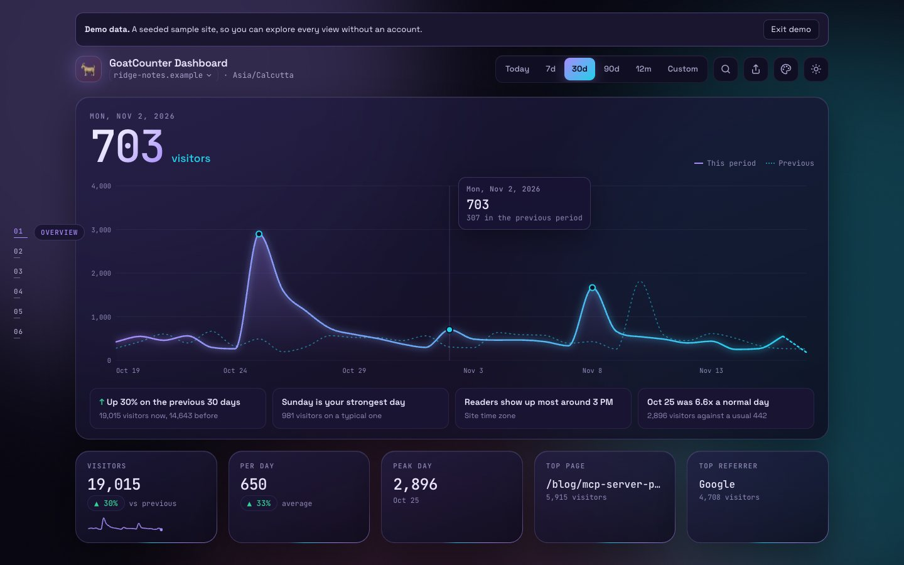
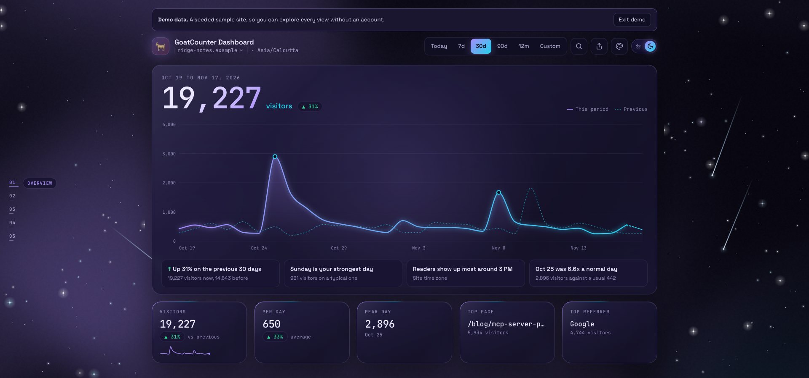
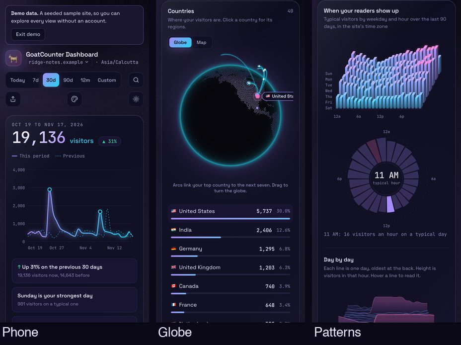
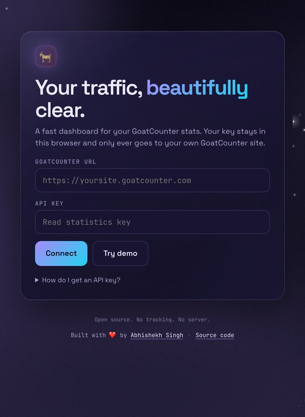
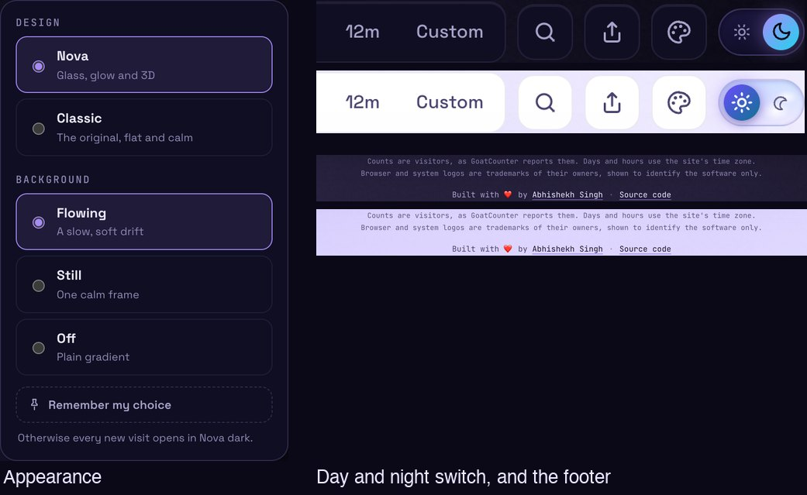

# 🐐 GoatCounter Dashboard

A fast, private dashboard for [GoatCounter](https://www.goatcounter.com/) analytics. It runs entirely in your browser: no server, no build step, no account, no tracking.

🔗 **Live**: [abhishekhsingh.github.io/goatcounter-dashboard](https://abhishekhsingh.github.io/goatcounter-dashboard/) (press **Try demo**, no key needed)



## ✨ Features

- **Two designs, each in dark and light.** **Nova** has glass cards, a globe, a calm animated background and, in dark mode on wide screens, stars and shooting stars. **Classic** is flat and calm. Switch mode with the sun and moon switch (`L`) and design in the Appearance panel (`N`).
- **Visitors over time** with a previous-period ghost line, marked spikes and plain-language highlights. Click a day to see its 24 hours.
- **All your sites** in one dashboard (`S`), and **one page at a time** with **Show only this page**.
- **Traffic**: top pages, referrers, and a Sankey from referrers to the pages they land on.
- **Audience**: a globe (or flat map) with country and region drill-down, and languages.
- **Rhythm**: a weekday-by-hour skyline, a 24-hour clock and a day-by-day ridgeline.
- **Your year**: a calendar, streaks and goal rings.
- **Tech**: browsers, systems, devices and campaigns.
- **Handy**: command palette (`/`), keyboard shortcuts, a section rail, and a shareable **recap image** (counts under 5 are left out).
- **Honest and private**: counts are visitors, days follow your site's time zone, there are no third-party requests, and your key only ever goes to your own GoatCounter site.
- **Accessible**: keyboard operable, labelled, respects reduced motion, axe clean.

## 🖼️ Screenshots







<details>
<summary>More screenshots</summary>

Sites and the page filter:


Command palette and recap image:


The connect screen:



Appearance, the day and night switch, and the footer:



</details>

## 🚀 Quick start

1. Open **[abhishekhsingh.github.io/goatcounter-dashboard](https://abhishekhsingh.github.io/goatcounter-dashboard/)**.
2. Enter your GoatCounter URL (for example `https://yoursite.goatcounter.com`) and an API key, or press **Try demo**.

## 🔑 Getting a GoatCounter API key

1. Log in to your GoatCounter site, click your username, then **API**.
2. Under **Add new API Token**, name it and tick **Read statistics**. Also tick **Read sites** to switch between your sites. Nothing else is needed.
3. Choose which sites the key can read, then **Add new**, and paste the key into the connect screen.

## 🏠 Self-hosting

It is a folder of static files. Put it on any static host (GitHub Pages, Netlify, Cloudflare Pages, S3, your own server).

1. **Fork** this repo and turn on **GitHub Pages** (Settings, Pages, source `main`, root).
2. Visit `https://<your-username>.github.io/goatcounter-dashboard`.

To run it locally, use any static server (browsers do not load ES modules from `file://`):

```bash
git clone https://github.com/abhishekhsingh/goatcounter-dashboard.git
cd goatcounter-dashboard
python3 -m http.server 8000   # open http://localhost:8000
```

There is no build step and nothing to install.

## ⌨️ Keyboard shortcuts

| Key | Action |
|---|---|
| `/` or Ctrl/Cmd + K | Command palette |
| `t` `w` `m` `q` `y` | Today, 7 days, 30 days, 90 days, 12 months |
| `l` / `n` | Light and dark / Nova and Classic |
| `s` | Switch site (when your key can read more than one) |
| `r` | Share a recap image |
| `Shift` + `R` | Refresh data (clears this site's cache) |
| Arrow keys | Move along the main chart (when focused) |

Shortcuts are ignored while you type in a field.

## ⚡ Performance

Measured on the live site in Chromium on a throttled phone (4x CPU, 1.6 Mbps, 150 ms round trip):

| Metric | Result |
|---|---|
| Transferred on first load | about 85 KB (connect screen), about 160 KB with the background |
| Connect screen usable | 1.2 s |
| Total blocking time | about 40 ms (connect screen) |

Native ES modules and a 7 KB UI library, with heavy parts (globe, background, stars, logos) loaded when needed. On an Apple M1 Pro at 2x it holds 60 frames a second through the whole page. The background and stars cost almost nothing and switch themselves off on weak devices, with reduced motion, or in Classic.

## 📡 How it talks to GoatCounter

It uses GoatCounter's read-only REST API (`/api/v0`) with your Bearer key: `/me`, `/sites`, and the `/stats/*` endpoints. A full load is about 22 requests. Requests go out one at a time to respect the 4 per second and 500 per hour limits, answers are cached in IndexedDB, and an hourly-limit notice shows saved numbers. The details (endpoints, caching, rate limits, time zones) are in [ARCHITECTURE.md](ARCHITECTURE.md).

## 🔒 Privacy and storage

Nothing is sent anywhere except your own GoatCounter site. Nothing loads from a CDN or Google Fonts. The credit line at the bottom links to the portfolio and the source, opens in a new tab and sends no referrer.

| Where | Key | What |
|---|---|---|
| localStorage | `gc-dashboard-config-v1` | Your GoatCounter URL and API key (removed on Disconnect) |
| localStorage | `gc-dashboard-range-v2` | Your last date range |
| localStorage | `gc-dashboard-goal-v1:<site>` | Your monthly goal |
| localStorage | `gc-dashboard-site-v1` | The site you had open (only with more than one) |
| localStorage | `gc-dashboard-pref` | Design, mode and background, only if you tick **Remember my choice** |
| sessionStorage | `gc-dashboard-session` | Design, mode and background for this tab |
| IndexedDB | `gc-dashboard` | Cached API answers |

A new visit opens in Nova dark. Changes last for the tab, and only **Remember my choice** keeps them for later visits. Use an `https://` URL for your GoatCounter site.

## 🌐 Browser support

Needs ES modules, import maps and the popover attribute: **Chrome or Edge 114+, Firefox 125+, Safari 17+**. The globe and the animated background need WebGL and fall back to a flat map and a plain gradient without it.

**Tested:** Chromium and WebKit (through Playwright) at 13 screen sizes from 280 px to 2560 px, in both designs and modes. **Not tested yet:** Firefox, and real phones or real Safari.

## 🛠️ Tech

No framework build and no bundler. Everything is plain files served as they are.

| Piece | Version | Licence |
|---|---|---|
| [Preact](https://preactjs.com/) + hooks | 10.25.4 | MIT |
| [htm](https://github.com/developit/htm) (JSX-like templates, no compile) | 3.1.1 | Apache-2.0 |
| [cobe](https://github.com/shuding/cobe) (WebGL globe) and phenomenon | 0.6.3, 1.6.0 | MIT |
| Space Grotesk, Inter, JetBrains Mono | variable, Latin | SIL OFL |
| Browser and system logos ([Simple Icons](https://simpleicons.org/)) | | CC0 |
| Country shapes (Natural Earth 110m via world-atlas) | | Public domain |

Libraries and fonts are vendored in `vendor/` and `fonts/` with their licences. Browser and system logos are trademarks of their owners, shown unaltered only to identify the software. Code layout, the two designs and how to update the libraries are in [ARCHITECTURE.md](ARCHITECTURE.md).

## 🤝 Contributing

PRs are welcome, against `dev`. Run `python3 -m http.server 8000`, edit `js/` and `css/`, reload. Only `scripts/` needs Node (see [scripts/README.md](scripts/README.md)).

- **No build step, no backend, no analytics or telemetry.** It must not phone home.
- **Credentials stay local** and go only to the user's GoatCounter site.
- **Stay deployable on any static host**, and keep the first load small (about 200 KB gzip).
- **Respect accessibility**: keyboard, labels, contrast, reduced motion, a text equivalent for new views.
- **Match the style**: Preact function components with htm, CSS custom properties for every colour, each design in its own stylesheet.
- **New dependencies need a strong reason** and an issue first.

Bugs and ideas: [GitHub Issues](https://github.com/abhishekhsingh/goatcounter-dashboard/issues). Connection problems: [Troubleshooting](TROUBLESHOOTING.md).

## 📄 License

MIT. See [LICENSE](LICENSE). Vendored libraries and fonts keep their own licences.

## Author

**Abhishekh Singh**: [portfolio](https://abhishekhsingh.github.io) and [@abhishekhsingh](https://github.com/abhishekhsingh) on GitHub.

GoatCounter is built by [Martin Tournoij](https://github.com/arp242). Please [support the project](https://www.goatcounter.com/) if you find it useful.
