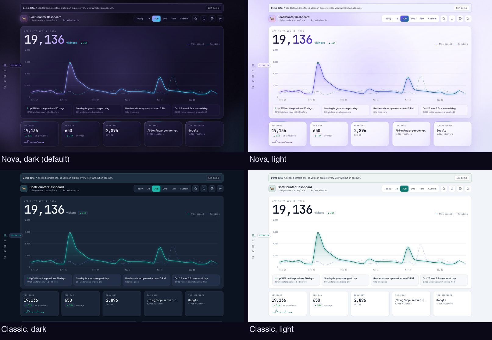
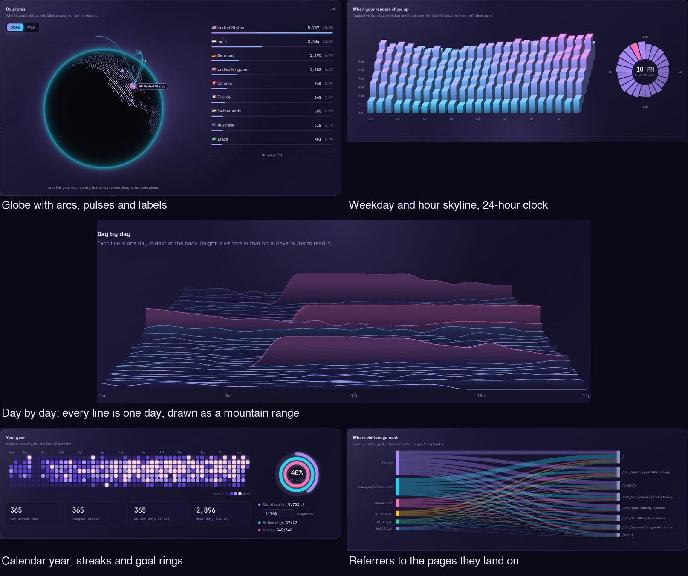
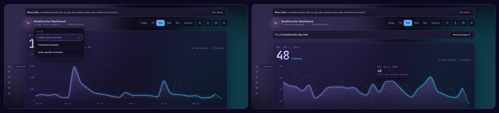
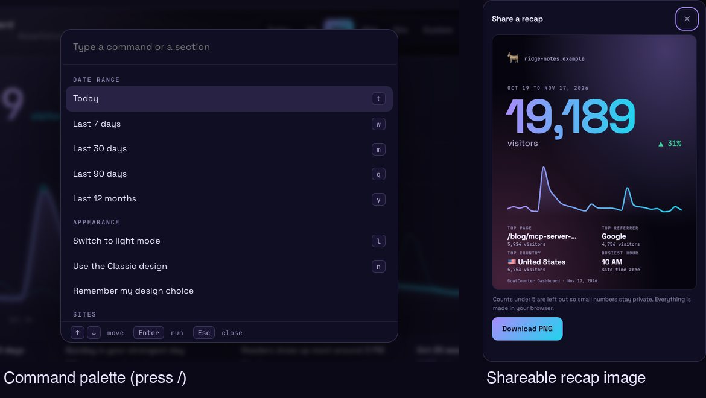

# 🐐 GoatCounter Dashboard

An open-source dashboard for [GoatCounter](https://www.goatcounter.com/) analytics. Two designs, a globe, a 3D skyline of when your readers show up, a calendar year with streaks, and a shareable recap image. It loads fast, runs entirely in your browser, and needs no server, no build step and no account.

🔗 **Live**: [abhishekhsingh.github.io/goatcounter-dashboard](https://abhishekhsingh.github.io/goatcounter-dashboard) (press **Try demo**, no key needed)


## ✨ Features

**Two designs, one engine**
- **Nova** (default): glass cards, a slow aurora, a glowing gradient line, tilting stat cards and a WebGL globe.
- **Classic**: the original flat, calm look, with the same data and the same features.
- Both come in dark and light. A new visit always opens in **Nova dark**. Your choice lasts for the tab, and you can tick **Remember my choice** to keep it for next time.

**Views**
- **Section rail**: a numbered rail on the left of wide screens (five sections: Overview, Traffic, Audience, Rhythm, Tech). The current section is underlined and named, and a click scrolls to it.
- **All your sites**: one key can open every site of your account. Pick a site from the name under the title (or press `s`), and your choice is remembered. It needs the **Read sites** permission; without it you see the one site the key was made for.
- **One page at a time**: open a page in Top pages and choose **Show only this page**. Every card narrows to that page until you press **Show all pages**.
- **Visitors over time**: a line that draws itself, a ghost line for the previous period, a dashed live edge, annotated spikes, and a crosshair that follows the pointer, touch or arrow keys. Click a day to zoom into its 24 hours.
- **Highlights**: plain sentences generated from your numbers, for example "Sunday is your strongest day".
- **Stat cards**: visitors, per day, peak, top page and top referrer, with trend chips and sparklines.
- **Top pages** with a sparkline each, and a referrer drill-down on click.
- **Referrers** with link, search and campaign tags, and the pages each one sends traffic to.
- **Where visitors go next**: a Sankey from your biggest referrers to the pages they land on.
- **Countries**: a globe (or a flat map) with flags and a region drill-down.
- **When your readers show up**: a 3D skyline by weekday and hour (a flat grid in Classic) and a 24-hour clock. Typical values, so one viral day cannot skew the pattern.
- **Your year**: a calendar of the last 12 months, streaks, and three goal rings against a monthly goal you can set.
- **Browsers, systems and devices** as donuts with real logos and a version drill-down.
- **Languages** and **campaigns** (the campaigns card stays hidden until there is data).

**Built to be used**
- **Command palette** (press `/` or Ctrl or Cmd + K) and keyboard shortcuts for ranges and designs.
- **Recap image**: a shareable 1080 x 1350 card made in your browser. Counts under 5 are left out so small numbers stay private.
- **Honest numbers**: GoatCounter counts visitors, so that is what is shown. Days and hours follow your site's time zone. A comparison is hidden when the earlier period has too little data.
- **Accessible**: keyboard operable, screen-reader labels, reduced motion respected, axe clean in both designs and both modes.
- **Private**: no analytics, no third-party requests (fonts and libraries are self-hosted), and your key is only ever sent to your own GoatCounter site.

## 🖼️ Screenshots

Both designs, dark and light:



The views:



On a phone:


Switching sites and narrowing to one page, with the section rail on the left:



The command palette and the recap image:



## 🚀 Quick start

1. Open **[abhishekhsingh.github.io/goatcounter-dashboard](https://abhishekhsingh.github.io/goatcounter-dashboard)**.
2. Enter your GoatCounter URL (for example `https://yoursite.goatcounter.com`) and an API key, or press **Try demo** to explore a seeded sample site.

## 🏠 Self-hosting

It is a folder of static files. Put it on any static host (GitHub Pages, Netlify, Cloudflare Pages, S3, your own server) and open it.

1. **Fork** this repo, or download it.
2. Turn on **GitHub Pages** (Settings, Pages, source `main`, root).
3. Visit `https://<your-username>.github.io/goatcounter-dashboard`.

To run it locally you need any static server, because browsers do not load ES modules from `file://`:

```bash
git clone https://github.com/abhishekhsingh/goatcounter-dashboard.git
cd goatcounter-dashboard
python3 -m http.server 8000
# open http://localhost:8000
```

There is no build step and nothing to install.

## 🔑 Getting a GoatCounter API key

1. Log in to your GoatCounter site.
2. Click your username in the top menu, then **API**.
3. Under **Add new API Token**, name it and tick **Read statistics**. Also tick **Read sites** if you want to switch between the sites of your account. Nothing else is needed.
4. Choose which sites the key can read, then **Add new**.
5. Copy the key into the connect screen.

## ⌨️ Keyboard shortcuts

| Key | Action |
|---|---|
| `/` or Ctrl/Cmd + K | Open the command palette |
| `t` `w` `m` `q` `y` | Today, 7 days, 30 days, 90 days, 12 months |
| `l` | Switch light and dark |
| `n` | Switch Nova and Classic |
| `s` | Switch site (when your key can read more than one) |
| `r` | Share a recap image |
| `Shift` + `R` | Refresh data (clears this site's cache and fetches everything again) |
| Arrow keys | Move along the main chart (when it has focus) |

Shortcuts are ignored while you type in a field.

## 💾 How "Remember my choice" works

A new visit always opens in Nova dark. A change of design or mode lasts for the tab (it survives reloads). Only if you turn on **Remember my choice** in the Appearance panel is it kept for later visits. Choices saved by older versions are ignored.

## ⚡ Performance

Measured in Chromium on a throttled phone profile (4x CPU slowdown, 1.6 Mbps, 150 ms round trip), served over HTTP/2 with gzip:

| | Before the rewrite | Now |
|---|---|---|
| Transferred on first load | about 970 KB | about 130 KB |
| Connect screen usable | 6.4 s | 1.0 s |
| Total blocking time | about 880 ms | about 115 ms |

The old version compiled React and Recharts in the browser through Babel. The current one uses native ES modules and a 7 KB UI library, with the heavy parts (globe, logos, recap fonts) loaded only when needed.

## 📡 API endpoints used

The dashboard talks to GoatCounter's read-only REST API (`/api/v0`) with a Bearer key.

| Endpoint | Used for |
|---|---|
| `GET /me` | Check the connection, read the account time zone |
| `GET /sites` | The sites of your account, for the site switcher (needs Read sites) |
| `GET /stats/total` | Visitors, the chart, the hour and weekday patterns, the calendar year |
| `GET /stats/hits` | Top pages and their daily series |
| `GET /stats/hits/{path_id}` | Where one page's visitors came from (on click) |
| `GET /stats/toprefs` and `/{id}` | Referrers, and the pages each referrer sends traffic to |
| `GET /stats/browsers`, `systems` (and `/{id}`) | Donuts, with versions on click |
| `GET /stats/sizes` | Devices |
| `GET /stats/locations` (and `/{id}`) | Countries, with regions on click |
| `GET /stats/languages` | Languages |
| `GET /stats/campaigns` (and `/{id}`) | Campaigns, shown only when there are some |

**Pages.** Narrowing to one page adds `include_paths=<page id>` to every statistics request, so each card shows that page alone.

**Request budget.** After connecting, the first screen needs five requests: `/me`, the current and previous `total`, `hits` and `toprefs`. Every other card loads when it scrolls near the viewport. The Sankey traces six referrers one at a time.

**Rate limits.** GoatCounter allows 4 requests per second, and (as observed on a hosted site) 500 per hour for a key. Requests go out one at a time with a short gap, and requests for a card you have already left (a new range, site or page) are dropped before they are sent. A short 429 or a network hiccup retries with a back-off. If the hourly cap is reached, the dashboard stops asking, shows a notice with the time it reopens, and keeps showing saved numbers; each card also has its own Retry button. A full load is about 22 requests, and answers are cached to keep that low.

**Caching.** Answers are cached in IndexedDB. A range that includes today counts as fresh for 60 seconds. A range that ended earlier counts as fresh for 6 hours. An older copy is shown instantly while a fresh one loads. The **Refresh** button in the header (or `Shift` + `R`) clears the cache for that site and fetches every visible card again. Disconnect clears it too.

**Time zones.** Days and hours are computed in the time zone GoatCounter reports for your account, falling back to your browser's.

## 🔒 Privacy and storage

The dashboard sends nothing anywhere except your own GoatCounter instance. Nothing is loaded from a CDN or from Google Fonts.

| Where | Key | What |
|---|---|---|
| localStorage | `gc-dashboard-config-v1` | Your GoatCounter URL and API key (removed on Disconnect) |
| localStorage | `gc-dashboard-range-v2` | Your last date range |
| localStorage | `gc-dashboard-goal-v1:<site>` | Your monthly goal |
| localStorage | `gc-dashboard-site-v1` | The site you had open (only when you use more than one) |
| localStorage | `gc-dashboard-pref` | Design and mode, only if you tick Remember my choice |
| sessionStorage | `gc-dashboard-session` | Design and mode for this tab |
| IndexedDB | `gc-dashboard` | Cached API answers |

Use an `https://` URL for your GoatCounter site. The connect form adds `https://` when you leave the scheme off but does not block a typed `http://`.

## 🌐 Browser support

You need a browser with ES modules, import maps and the popover attribute: **Chrome or Edge 114+, Firefox 125+, Safari 17+**. The globe needs WebGL and falls back to the flat map without it. The scroll and view-transition effects are optional and degrade quietly.

**Tested:** Chromium (the engine behind Chrome and Edge) and WebKit (the engine behind Safari), through Playwright, at 13 screen sizes from a 280px foldable to a 2560px ultrawide, in both designs and both modes, with keyboard, palette and recap checks. **Not tested yet:** Firefox, and real phones or real Safari.

## 🛠️ Tech

No framework build and no bundler. Everything is plain files served as they are.

| Piece | Version | Licence | Where |
|---|---|---|---|
| [Preact](https://preactjs.com/) + hooks | 10.25.4 | MIT | `vendor/` |
| [htm](https://github.com/developit/htm) (JSX-like templates, no compile) | 3.1.1 | Apache-2.0 | `vendor/` |
| [cobe](https://github.com/shuding/cobe) (WebGL globe) and its dependency phenomenon | 0.6.3, 1.6.0 | MIT | `vendor/`, loaded lazily |
| Space Grotesk, Inter, JetBrains Mono | variable, Latin | SIL OFL | `fonts/` |
| Browser and system logos | [Simple Icons](https://simpleicons.org/) | CC0 | `js/icons.js` |
| Country shapes | Natural Earth 110m via world-atlas | Public domain | `assets/world-map.js` |

Browser and system logos are trademarks of their owners. They are shown unaltered, only to identify the software, and imply no endorsement.

How the code is organised, how to update the vendored libraries and how the two designs work are in [ARCHITECTURE.md](ARCHITECTURE.md).

## 🤝 Contributing

PRs are welcome. The flow for most changes:

1. Fork and clone.
2. Run `python3 -m http.server 8000` and open the demo.
3. Edit the files under `js/` and `css/`, and reload.
4. Open a PR against `dev`.

Only `scripts/` needs Node, and only to regenerate the world map; see [scripts/README.md](scripts/README.md).

### Project rules

- **No build step.** Source files are what the browser runs. Libraries are vendored in `vendor/` with their licences, not loaded from a CDN.
- **No analytics, telemetry or tracking.** It must not phone home.
- **No backend.** No proxy, serverless function or edge worker. Everything runs in the browser against the GoatCounter API.
- **Credentials stay local** and go only to the user's GoatCounter site. Never log or send a key anywhere else.
- **Stay deployable on GitHub Pages** and any other static host.
- **Keep the first load small.** The budget is about 200 KB gzip for the first screen. Heavy features load lazily and pause when offscreen.
- **Respect accessibility.** Keyboard access, labels, contrast and reduced motion. New views need a text equivalent.
- **Match the style.** Preact function components with htm templates, CSS custom properties for every colour, and each design in its own stylesheet.
- **New dependencies need a strong reason** and an issue first.

Bug reports and ideas: [GitHub Issues](https://github.com/abhishekhsingh/goatcounter-dashboard/issues).

## 🔧 Troubleshooting

Having trouble connecting? See the [Troubleshooting guide](TROUBLESHOOTING.md).

## 📄 License

MIT. See [LICENSE](LICENSE). Vendored libraries and fonts keep their own licences, included beside them.

## Author

**Abhishekh Singh**
- Portfolio: [abhishekhsingh.github.io](https://abhishekhsingh.github.io)
- GitHub: [@abhishekhsingh](https://github.com/abhishekhsingh)

GoatCounter itself is built by [Martin Tournoij](https://github.com/arp242) and is great. Please [support the project](https://www.goatcounter.com/) if you find it useful.
